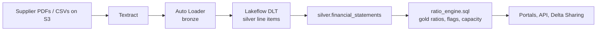

# CreditSource-style Supplier Financial Risk Platform — Reference Design

A reference architecture and starter code for a supplier financial risk platform modelled on the
services CreditSource publicly describes: **financial risk assessments**, **ongoing supplier
monitoring** and **custom financial data**.

> **Disclaimer:** This is a *hypothetical* design inferred from CreditSource's public website and
> capability statement. It is not CreditSource's actual architecture. Technology choices,
> thresholds and data schemas are illustrative.

## Repository layout

```
.
├── README.md
├── databricks.yml                         # Databricks Asset Bundle: pipeline + ratio job
├── docs/
│   ├── architecture/
│   │   ├── 01-tech-stack-overview.md      # Layered stack and integration points
│   │   ├── 02-c4-context.md               # C4 Level 1 — system context
│   │   ├── 03-c4-containers.md            # C4 Level 2 — containers + technology tags
│   │   └── 04-databricks-lakehouse.md     # Databricks functions + third-party integrations
│   └── research/
│       ├── service-overview.md            # Services, supplier role, financial statement structure
│       └── market-comparison.md           # Competitors, Archer TPRM, individual credit checks
├── pipelines/
│   └── supplier_financials_pipeline.py    # Lakeflow (DLT) + Auto Loader: bronze -> silver
├── sql/
│   └── ratio_engine.sql                   # Spark SQL ratio engine: silver -> gold
└── ref/
    └── coa_mapping_seed.sql               # Seed chart-of-accounts label mapping
```

## Data flow



## Getting started

1. Create the Unity Catalog objects: catalog `creditsource`, schemas `ref`, `silver`, `gold`.
2. Seed the mapping table: run `ref/coa_mapping_seed.sql`.
3. Configure S3 landing paths in `databricks.yml` (`textract_landing`, `template_landing`).
4. Deploy and run:
   ```bash
   databricks bundle validate
   databricks bundle deploy -t dev
   databricks bundle run supplier_financials_pipeline -t dev
   databricks bundle run ratio_engine_job -t dev
   ```

## Status

Starter code — syntax-checked but **not yet run on a Databricks workspace**. Test in a dev
target before production use.

## Sources

- [CreditSource — Supplier Financial Risk](https://creditsource.com.au/supplier-financial-risk/)
- [CreditSource Capability Statement (PDF)](https://creditsource.com.au/wp-content/uploads/2025/06/CreditSource-Capability-Statement.pdf)
