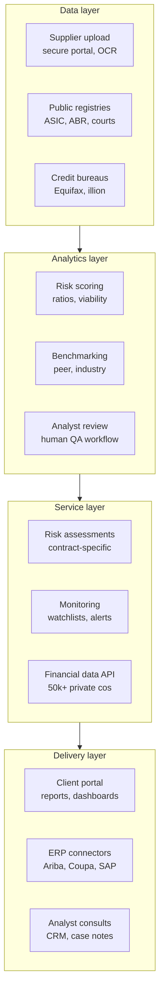

# 01 — Integrated Tech Stack Overview

The platform delivers three services from one integrated stack:

| Service | What it does |
|---|---|
| Financial risk assessments | Forward-looking, contract-specific supplier viability reports, analyst-reviewed, 48-hour turnaround |
| Supplier financial monitoring | Ongoing alerts (liquidity, court actions, defaults, sanctions/PEP, adverse media) across the contract lifecycle |
| Custom financial data | Verified, structured financials on ~50,000 AU/NZ companies via reports, dashboards, CSV or API |

## Layered view

Data flows **up** from sources to the client.

## Key integration points

- **One supplier record (keyed on ABN/ACN).** Assessments, monitoring and the data product share
  the same entity, so an assessment automatically seeds the monitoring watchlist.
- **Automated collection.** Suppliers upload financials through a secure portal; OCR and parsing
  produce structured statements — no manual chasing.
- **Scoring feeds monitoring.** Registry, court and bureau events trigger re-scoring and push
  alerts to the portal or ERP.
- **Human in the loop.** Every model output passes an analyst review queue before release; notes
  are logged in a CRM so consultations have full context.
- **API-first delivery.** Risk ratings sync into procurement/ERP/GRC tools so buyers see supplier
  viability at award time.
