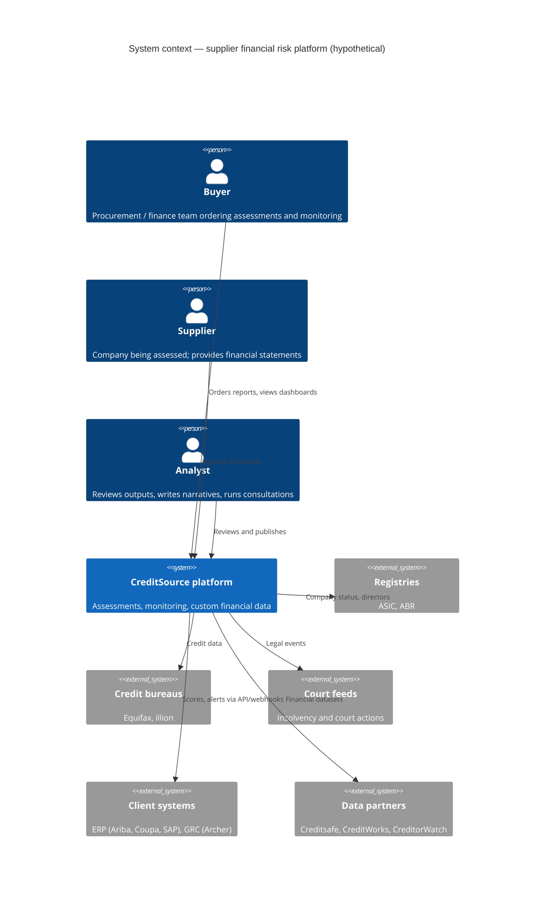

# 02 — C4 Level 1: System Context

Who uses the platform and which external systems it depends on.

## Actors

| Actor | Role |
|---|---|
| Buyer | Provides supplier name, ABN/ACN, contact and contract value; receives report, consultation, alerts |
| Supplier | Subject of the assessment; uploads statements; triggers the 48-hour clock |
| Analyst | Reviews every report and alert before release |

## External systems

| System | Direction | Purpose |
|---|---|---|
| ASIC / ABR | In | Company status, director changes, industry classification |
| Equifax / illion | In | Credit history, defaults, enquiries |
| Court / insolvency feeds | In | Winding-up applications, judgments |
| Client ERP / GRC | Out | Ratings and alerts at award time and during contract |
| Data partners | Out | Supply of AU/NZ financial data |
