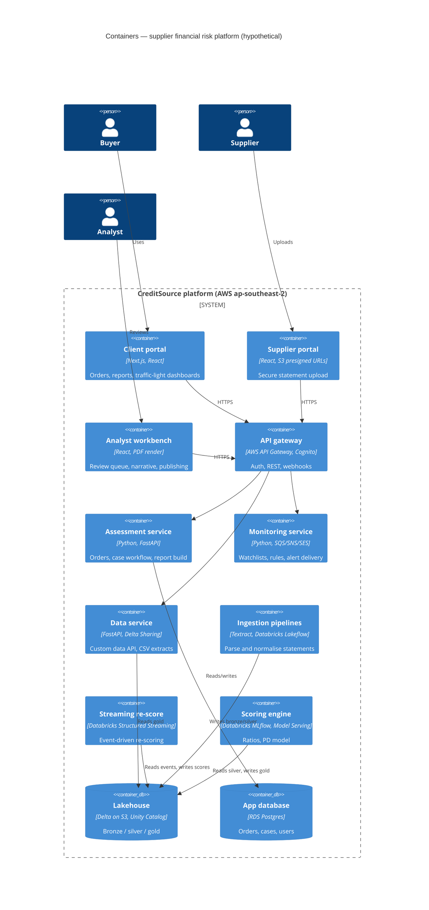

# 03 — C4 Level 2: Containers

Deployable parts of the platform, with **likely** technology choices (assumptions, not confirmed).
Hosting: AWS Sydney region (keeps supplier financials onshore for government clients).

## Container summary

| Container | Technology (likely) | Responsibility |
|---|---|---|
| Client portal | Next.js, React | Ordering, report viewing, dashboards |
| Supplier portal | React, S3 presigned uploads | Secure upload of statements |
| Analyst workbench | React, PDF rendering | Review queue, narrative, publish |
| API gateway | AWS API Gateway, Cognito | Auth, routing, client webhooks |
| Assessment service | Python, FastAPI | Order intake, case workflow, report assembly |
| Monitoring service | Python, SQS/SNS/SES | Watchlists, rules, alert fan-out |
| Data service | FastAPI, Delta Sharing | Data product: API, CSV, partner shares |
| Ingestion pipelines | Textract + Databricks Lakeflow | Extract, clean, map statements |
| Streaming re-score | Databricks Structured Streaming | Re-score on bureau/court/registry events |
| Scoring engine | Databricks MLflow, Model Serving | Ratio engine, PD model, real-time scores |
| Lakehouse | Delta on S3, Unity Catalog | Medallion storage, governance, lineage |
| App database | RDS Postgres | Transactional app data |

## Main flows

1. **New assessment** — buyer orders → assessment service opens a case → checks existing data →
   if missing, supplier receives a portal link → upload → ingestion and OCR normalise to the
   chart of accounts → scoring engine computes ratios and PD → analyst reviews in the workbench →
   report published to the client portal.
2. **Monitoring** — bureau, court and registry events stream in → re-scoring → watchlist rules →
   analyst vets → alert to dashboard or client webhook.
3. **Data product** — data service reads gold tables for partners (Delta Sharing) and clients
   (API/CSV).

## Alternatives

Azure (Document Intelligence, Service Bus) or a .NET backend are plausible substitutes common in
Australian financial services.
