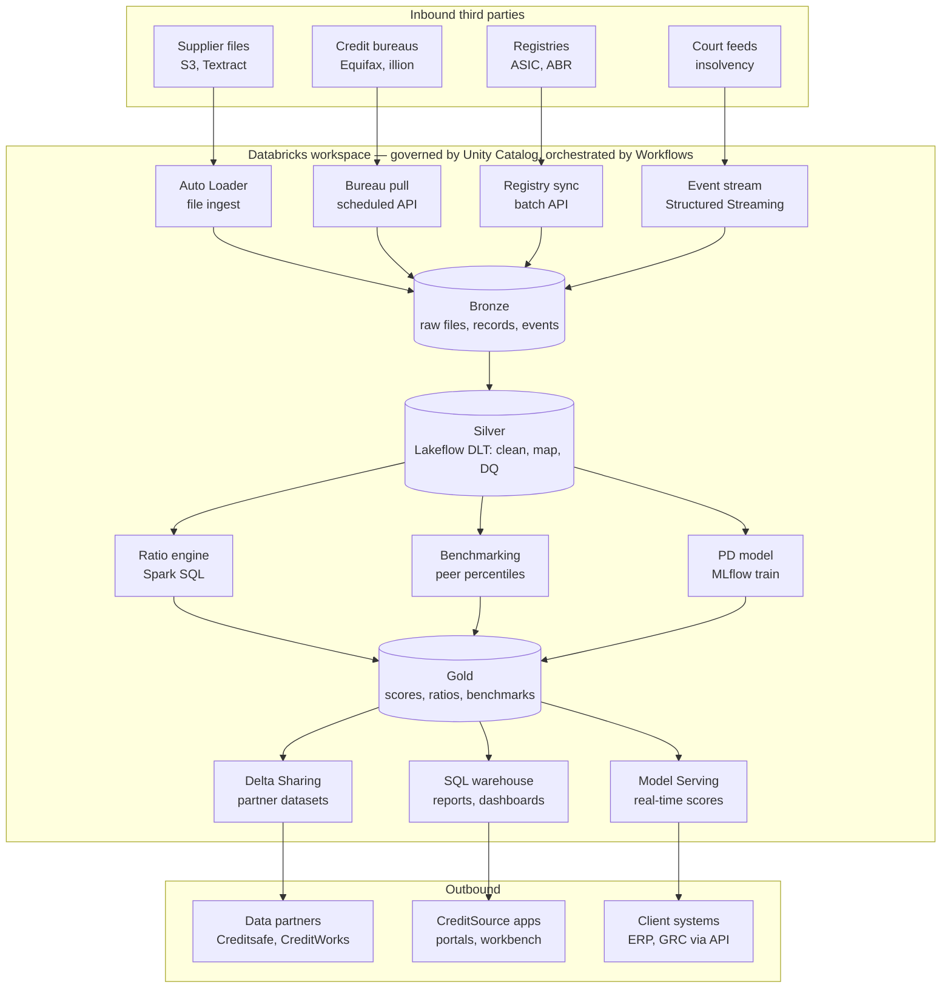

# 04 — Databricks Lakehouse: Functions and Third-Party Integration

Databricks sits beneath the operational services as the analytics and data layer. It replaces a
separate warehouse (e.g. Snowflake) and hosts ingestion, scoring, benchmarking and serving.

## Databricks functions

| Function | Databricks feature | Purpose |
|---|---|---|
| File ingest | Auto Loader | Incremental pickup of Textract JSON and CSV templates |
| Bureau / registry ingest | Workflows jobs | Scheduled REST pulls |
| Event ingest | Structured Streaming | Court/insolvency and bureau alerts in near real time |
| Cleansing and mapping | Lakeflow Declarative Pipelines (DLT) | Normalise labels and units, map to chart of accounts, data-quality expectations |
| Ratios | Spark SQL (`sql/ratio_engine.sql`) | Liquidity, leverage, profitability, efficiency, trends, contract capacity |
| Benchmarking | Spark batch | Industry and peer percentiles across ~50k companies |
| Probability of default | MLflow + Model Serving | Train, version, audit and serve PD models |
| Serving | SQL warehouse, Delta Sharing, Model Serving | Reports, partner datasets, real-time scores |
| Governance | Unity Catalog | Access control, lineage from upload to report, audit |

## Medallion layers

| Layer | Contents |
|---|---|
| Bronze | Raw Textract JSON, CSV uploads, bureau records, registry snapshots, events |
| Silver | `silver_line_items`, `silver_unmapped_lines`, `financial_statements` (one row per ABN + FY) |
| Gold | `supplier_ratios`, `supplier_ratio_flags`, `contract_capacity`, benchmarks, PD scores |

## Third-party integration

| Third party | Direction | Mechanism |
|---|---|---|
| Suppliers | In | Upload to S3 → Textract → Auto Loader |
| Equifax, illion | In | Scheduled REST pulls (Workflows job) |
| ASIC, ABR | In | Batch API sync: company status, director changes |
| Court / insolvency feeds | In | Webhooks / queue → Structured Streaming |
| Creditsafe, CreditWorks | Out | Delta Sharing (no copies) |
| Client ERP / GRC (Ariba, Archer) | Out | API gateway → Model Serving, plus webhooks |

## What stays outside Databricks

Front-ends, API gateway, assessment/monitoring/data services, alert delivery (SQS/SNS/SES) and the
transactional RDS Postgres database.
